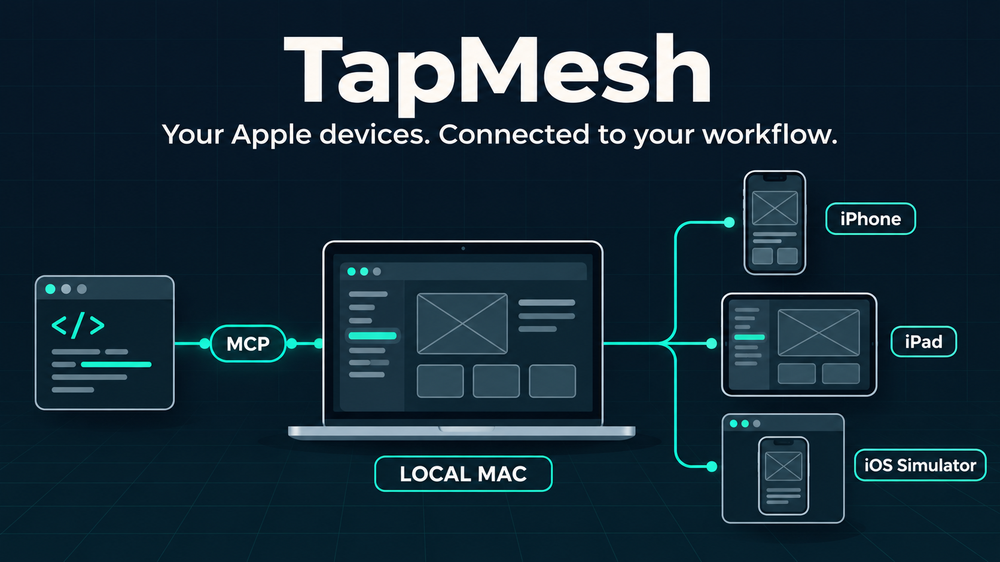
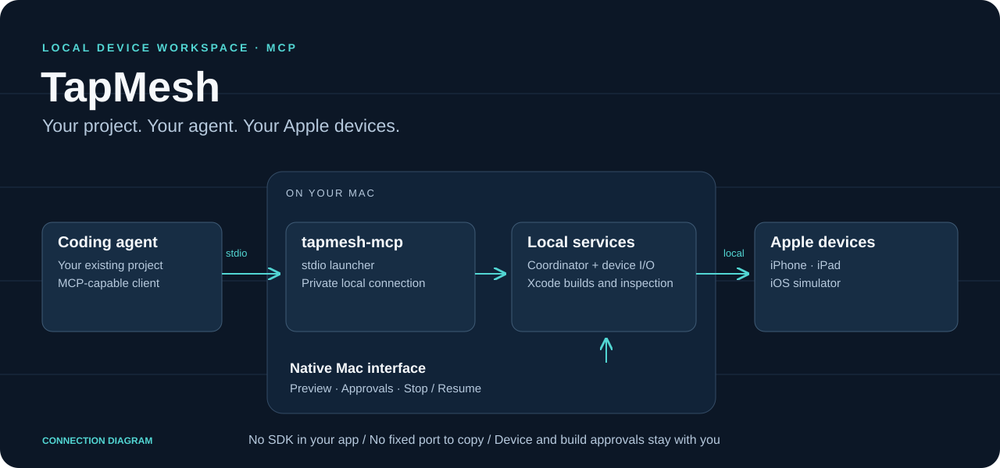
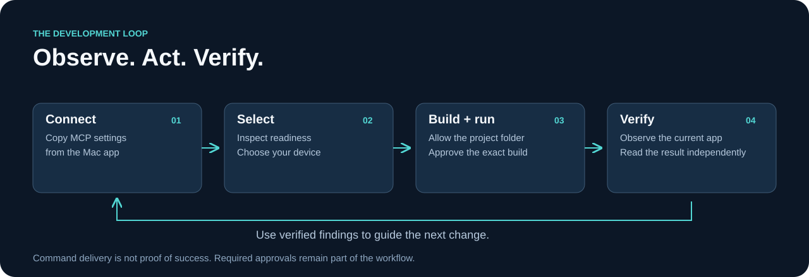

<div align="center">

# TapMesh

**A local Mac workspace for Apple devices and AI coding agents.**

View the screen. Build your app. Inspect what actually happened.

[](https://github.com/khaled1174/TapMesh/actions/workflows/verify.yml)


[](LICENSE)

[Get started](#get-started) · [Connect your agent](docs/CONNECTING_AGENTS.md) · [Architecture](docs/ARCHITECTURE.md) · [Build from source](docs/SOURCE_BUILD.md)

</div>



<sub>Connection illustration; device screens are conceptual.</sub>

> **0.2.0 Developer Preview** — source is available. Binary candidates stay in draft releases until their exact artifacts pass the [release gates](docs/RELEASE_STATUS.md). This is not a general-availability release.

## One workspace, two ways to work

Use the native Mac app directly, or connect your existing coding agent through **MCP**. TapMesh provides device access; your agent continues editing the project with its usual tools. No TapMesh SDK belongs in your iOS app.

| In the Mac app | From an MCP client |
| --- | --- |
| Select a device and watch its screen | Discover devices and inspect readiness |
| Tap, swipe, type and open apps | Use supported control tools on authorized devices |
| Inspect elements and save captures | Receive screenshots as MCP image content |
| Review approvals and pause agent input | Build, install and launch an approved Xcode project |

Wired iPhone and iPad devices can use live video. Simulators and Wi-Fi devices use refreshed screenshots. Available capabilities depend on the selected device and OS version.

## Get started

**Requirements:** Apple Silicon, macOS 15 or later, and Xcode installed and initialized for device work. For simulators, install an iOS runtime in Xcode. For physical devices, connect by cable, unlock the device, trust the Mac and enable **Settings › Privacy & Security › Developer Mode** when required.

1. Check [release status](docs/RELEASE_STATUS.md). When a qualified preview is published in [Releases](https://github.com/khaled1174/TapMesh/releases), open its DMG and drag **TapMesh.app** into **Applications**. Eject the image and open the app from Finder. A release ZIP can also be extracted into Applications.
2. Select a device in the sidebar. Follow any setup instructions, then choose **Check Again**. Start a simulator if needed.
3. Use the preview directly, or connect an agent using the next section.

The app bundles its local services. Closing the window keeps them available to clients; quitting TapMesh stops its owned services. You do not install a separate Python environment to use the packaged app. Developers can [build from source](docs/SOURCE_BUILD.md).

## Connect your agent

Open **Settings › AI Agents** or **Help › Connect an AI Agent…** and copy the configuration for your actual installation. For clients using `mcpServers` JSON, a standard Applications install looks like this:

```json
{
  "mcpServers": {
    "tapmesh": {
      "command": "/Applications/TapMesh.app/Contents/MacOS/tapmesh-mcp"
    }
  }
}
```

For Claude Code, run this in your project directory:

```sh
claude mcp add tapmesh -- '/Applications/TapMesh.app/Contents/MacOS/tapmesh-mcp'
```

Reconnect the client, ask it to call `list_devices`, then `select_device` for the device you authorize. The launcher uses **MCP over stdio** and manages its authenticated local connection privately. No fixed port, cloud account or copied token is required. The MCP process runs on the Mac with device access.

A skill or `AGENTS.md` file can teach the workflow; **MCP supplies the tools**. Connecting MCP does not automatically add a phone panel to every IDE. TapMesh has its own preview, and MCP screenshots appear in clients that support image content.

[Complete connection guide](docs/CONNECTING_AGENTS.md) · [Copyable JSON](examples/mcp/tapmesh.json) · [Project instruction template](examples/mcp/project-instructions.md)



## Use it with a project



1. Give the agent the `.xcworkspace` or `.xcodeproj` path, shared scheme, configuration and bundle ID. Prepare generated workspaces and framework-specific development servers using the project's normal tools.
2. Allow the project folder in **Settings › Build Folders**. A build still needs host-execution approval.
3. Ask the agent to use `build_and_run`, then inspect the returned build, install and launch stages.
4. Verify the foreground app and current screen with `get_foreground_app`, `take_screenshot` and supported element inspection. After input, read the application result independently.

For example:

> Use TapMesh MCP for `/path/MyApp/MyApp.xcworkspace`, scheme `MyApp`, bundle ID `com.example.myapp`. List devices and select the iPhone I authorize. Build and launch, then verify the main screen is visible. Stop for required approvals and stay within this app.

A delivered input command is not proof of the expected result. The Mac interface and each MCP client maintain independent device selections. [Architecture and verification methodology](docs/ARCHITECTURE.md)

## Control stays with you

Ordinary agent control on a new physical device needs your per-device consent. With fast control enabled, approved ordinary actions can run immediately. Turning it off requires approval for each ordinary action. Use **Stop** to pause other clients' writes and **Resume** to continue. Revoke device access in **Settings › General**.

| Operation | Required boundary |
| --- | --- |
| Ordinary control of a new physical device | Owner's device consent |
| Clipboard, saved recordings and simulated location | Sensitive approval (`S`) |
| Uninstalling or replacing an app | Destructive confirmation (`D`) |
| Running a project build | Allowed folder and host-execution approval (`H`) |
| Unlocking and other protected steps | Direct human action (`U`) |

Agents cannot approve their own requests. The current preview removed the older screenshot-comparison and text-field preflight; observe the destination before typing and inspect the field after interruptions. Enter passcodes and credentials directly on the device. [All 50 tool contracts](docs/TOOL_CONTRACTS.md) · [Preview behavior and limits](docs/RELEASE_NOTES_0.2.0.md)

## Privacy and practical limits

The app, device services, screen processing and storage run on your Mac. An external AI client decides how it handles screenshots and tool results you give it. The approval credential stays in memory. Private profiles and device captures do not belong in project source or MCP configuration.

- **USB video:** one active USB tunnel at a time; screenshot fallback is available according to device capabilities.
- **Orientation:** physical input support varies. Use portrait for general input and landscape-left where the capability lists support.
- **iOS compatibility:** device interfaces can change after OS updates. Read the current readiness and capability details.
- **Files:** Saved Files shows session captures and stored usage. Each service removes artifacts older than 30 days and caps its store at 5 GiB. Derived build data older than seven days is pruned at device-service startup. Exported copies remain in their chosen folders.

To uninstall, quit and delete **TapMesh.app**. Removing `~/Library/Application Support/TapMesh` and `~/Library/Caches/TapMesh` also removes default local profiles, saved files, device permissions and caches.

## Documentation and source

| Topic | Guide |
| --- | --- |
| MCP setup, projects and screen previews | [Connect agents](docs/CONNECTING_AGENTS.md) |
| Components, transport and verification loop | [Architecture](docs/ARCHITECTURE.md) |
| Exact arguments and approval classes | [Tool contracts](docs/TOOL_CONTRACTS.md) |
| Compile, package and verify | [Source build](docs/SOURCE_BUILD.md) |
| Current candidate and open gates | [Release status](docs/RELEASE_STATUS.md) |
| Redistributed dependency sources | [Dependency sources](docs/DEPENDENCY_SOURCES.md) |

TapMesh is **GPL-3.0-or-later**. Every public binary must include its matching complete corresponding-source archive. [License](LICENSE) · [Notices](NOTICE)
