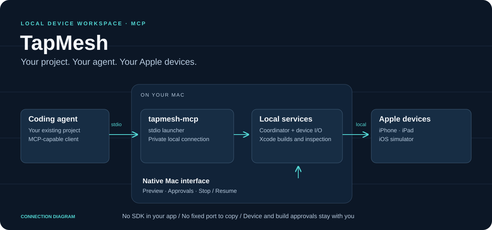
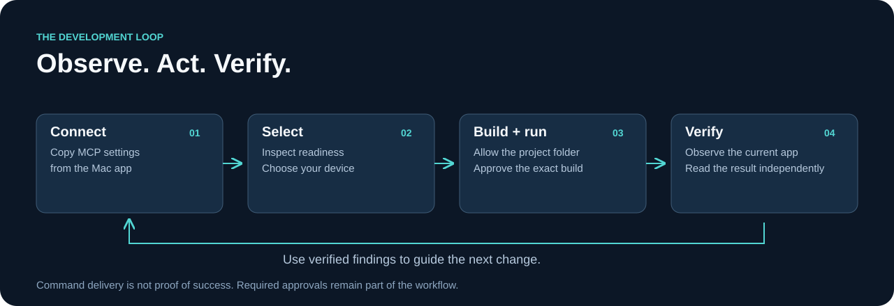

# Architecture and development methodology

TapMesh joins a native Mac workspace, a local MCP endpoint and Apple device tools.
The coding agent owns source changes; TapMesh provides inspection and approved
build/device operations. No TapMesh library is linked into the target iOS app.

## Components and connection

| Component | Responsibility |
| --- | --- |
| Coding agent | Edit project files, prepare framework prerequisites and call MCP tools |
| `tapmesh-mcp` | Provide MCP over stdio and attach to the installed app's local services |
| Local coordinator | Expose tool contracts, maintain client sessions and enforce approvals |
| Device service | Discover supported Apple devices, build through Xcode and perform supported device operations |
| Native Mac workspace | Show preview, readiness, approvals, saved files and Stop/Resume |
| Target app | Run as an ordinary iOS application on the selected device |

The launcher uses the app's private connection state. Local HTTP services use
authentication; the stdio client does not need exported credentials or a fixed
port. Approval credentials stay in memory. Do not commit connection files or
tokens. The Mac app, Xcode, MCP process and device connection must run on the
Mac; copying a Mac executable path to a remote agent host does not connect it.
Use that client's supported host connection if it provides one.

Each MCP session explicitly selects its device. The Mac interface selects its
preview independently. An agent can return `take_screenshot` image content,
but the client's image support determines where it appears. TapMesh does not
inject a device panel into arbitrary IDEs.

## Development loop

1. **Connect:** install the app and configure the client's stdio MCP server.
2. **Discover:** inspect readiness and capabilities, then select the authorized
   device in that client session.
3. **Prepare:** supply the workspace/project path, shared scheme, configuration
   and bundle ID. Initialize Xcode, prepare generated workspaces and resolve
   signing/provisioning through the project's normal process.
4. **Build and run:** allow the project folder in Settings. Approve the exact
   host-execution request. Inspect each build, install and launch result.
5. **Observe:** verify the foreground app, screenshot and supported element data.
6. **Act and verify:** perform the intended action and independently inspect the
   resulting app state. An accepted or transmitted command does not establish
   success. If the outcome is uncertain, inspect before repeating input.

MCP is the operational connection. A skill or project instruction file describes
how an agent should use it. The repository's [project instruction template](../examples/mcp/project-instructions.md)
is a reusable instruction example, not a separately installed skill or permission.

## Owner control and observation

Ordinary physical-device control needs per-device owner consent. Sensitive,
destructive and host-execution operations retain their own approval classes.
Protected steps require direct human action. Stop/Resume controls let the owner
pause writes from other clients. Agents cannot approve themselves.

The 0.2.0 preview removed the earlier physical-text screenshot comparison and
field preflight. Preview the destination before input, and check the result
after interruption. Device support, transport and orientation are explicit
capabilities, not guarantees of every operation. Wired live video and refreshed
screenshots are distinct preview paths.

## Release verification is separate

Source tests verify contracts and implementation behavior. Local bundle checks
verify packaging, signatures, relocation and service startup. Those checks do
not replace an attended device trial or clean-Mac installation/update of the
exact candidate. Apple notarization is also tracked per artifact.

Candidates remain in draft releases while required gates are open. Public
binaries require matching complete corresponding source. Historical reports
remain tied to their original builds. Read [release status](RELEASE_STATUS.md)
for the current candidate rather than inferring readiness from a badge.

[Connection setup](CONNECTING_AGENTS.md) · [Tool contracts](TOOL_CONTRACTS.md) · [Build from source](SOURCE_BUILD.md)
