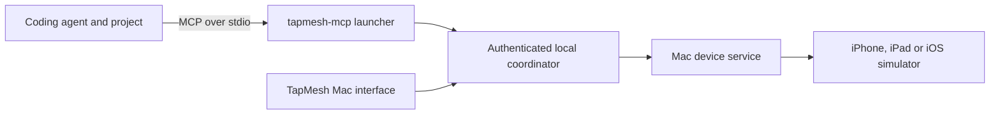

# Connect TapMesh to an AI agent and a project

[العربية](CONNECTING_AGENTS.ar.md) · [Installation](../README.md) · [Tool contracts](TOOL_CONTRACTS.md)

TapMesh exposes an MCP server. Your coding agent edits the project's source and
uses TapMesh to discover devices, build an iOS app, install and launch it, inspect
the screen, and perform supported device actions. No TapMesh SDK is required in
your app. A skill or a project instruction file can describe your workflow; it
does not replace the MCP connection or grant permission to use a device.

These instructions describe the 0.2.0 Developer Preview source. See
[release status](RELEASE_STATUS.md) before choosing a binary. Publishing this
source does not publish or qualify a binary release.



The launcher, TapMesh services, Xcode and device connection run on the Mac.
A remote coding environment cannot execute a Mac app merely by copying its
local path; the MCP process must run on the Mac through the client's supported
host connection.

## 1. Connect the MCP client

Open **Settings › AI Agents** or **Help › Connect an AI Agent…** in TapMesh.
Copy the configuration generated for the actual installation path. Earlier
builds without that screen can use the manual configuration below.

For clients using the `mcpServers` JSON format:

```json
{
  "mcpServers": {
    "tapmesh": {
      "command": "/Applications/TapMesh.app/Contents/MacOS/tapmesh-mcp"
    }
  }
}
```

The server uses **stdio**. The JSON is a client configuration, not a file to add
to the iOS application. Use your client's own settings format if it differs.
Replace the command with the real absolute path if TapMesh is installed
elsewhere. JSON does not expand `~`. The in-app copy button handles the path.
A copyable example is [examples/mcp/tapmesh.json](../examples/mcp/tapmesh.json).

For Claude Code, run the following in the project directory for the default
local scope, or copy the equivalent command from TapMesh:

```sh
claude mcp add tapmesh -- '/Applications/TapMesh.app/Contents/MacOS/tapmesh-mcp'
```

Use `--scope user` if you want the connection available across your projects:

```sh
claude mcp add --scope user tapmesh -- '/Applications/TapMesh.app/Contents/MacOS/tapmesh-mcp'
```

Reload or reconnect the MCP server in your client. It should discover 50 tools,
including `list_devices`, `select_device`, `take_screenshot` and `build_and_run`.
The launcher reads the local connection privately and starts TapMesh when its
services are unavailable. Keep TapMesh running during the session; closing its
window keeps services available, while quitting stops its owned services.
Do not copy connection files, tokens or approval credentials into MCP settings,
project instructions or Git. No fixed port or cloud account is required.

## 2. Give the agent the project information

For a direct Xcode build, provide:

- The full path to the `.xcworkspace` or `.xcodeproj`, not just its parent folder.
- The shared scheme name and build configuration, usually `Debug`.
- The app's bundle ID, for example `com.example.myapp`.
- The device you authorize the agent to use and a visible success condition.

Xcode must be installed and initialized. A physical-device build needs working
signing and provisioning for that project. Prepare generated iOS workspaces or
other framework prerequisites with the project's normal tools first. TapMesh's
`build_and_run` invokes `xcodebuild`; it does not create an iOS app from an
arbitrary web or backend project or start framework-specific development servers.

For repeat use, copy the [project instruction template](../examples/mcp/project-instructions.md)
into the instruction file your agent reads, such as `AGENTS.md`, and replace the
placeholders. It is a template, not an installed TapMesh skill.

## 3. Allow the build folder

In **Settings › Build Folders**, allow the folder containing the Xcode project
or workspace. Follow any displayed restart requirement so the local services
use the updated folder grants. A folder grant does not approve every build:
`build_and_run` still requires host-execution approval in TapMesh.

The MCP client cannot approve its own requests. On a new physical device, you
decide whether agents may use ordinary control. Sensitive, destructive, build
and protected operations retain their respective approval or human-action
requirements. Use TapMesh's **Stop** and **Resume** controls when needed.

## 4. Build, run and verify

Ask the agent to use this sequence:

1. Call `list_devices`, inspect readiness and capabilities, and use
   `select_device` for the intended device in this MCP session.
2. Call `build_and_run` with `project_path`, `scheme`, `configuration` and
   `launch: true`. Respond to the build approval in TapMesh.
3. Inspect every returned build/install/launch stage. For a prebuilt supported
   app, use `install_app` and `launch_app` with the required approvals instead.
4. Call `get_foreground_app`, `take_screenshot` and, when supported,
   `list_elements` to verify the expected app and screen.
5. Before further input, observe the current screen. After input, verify the
   application result independently. A delivered command is not proof that the
   expected screen or field changed. Do not blindly replay an uncertain action.

Example request:

> Use TapMesh MCP for this project. Workspace: `/path/MyApp/MyApp.xcworkspace`.
> Scheme: `MyApp`. Bundle ID: `com.example.myapp`. List devices and select the
> iPhone I authorize. Build and launch the app, then verify that its main screen
> is visible. Stop for required approvals and do not operate unrelated apps.

## Where the screen appears

Select the same device in the TapMesh sidebar to watch its preview. Each MCP
client and the Mac interface have independent device selections. Selecting a
device in the app does not select it for the agent, and vice versa.

`take_screenshot` returns MCP image content plus observation metadata. Whether
that image appears in an AI client's chat depends on the client's image support.
Adding the MCP server does not automatically create a phone panel in every IDE.
TapMesh provides its own device preview; its wired USB video and screenshot
fallback capabilities are described in the [installation guide](../README.md).

## Troubleshooting

- **Launcher missing:** install the complete `.app` bundle and copy its actual
  launcher path. A source checkout alone is not that installed launcher.
- **No tools:** reload the MCP connection and check the client's server errors.
- **No selected device:** call `list_devices` and `select_device` in the agent's
  own session. Check the device's capability/readiness reasons.
- **Physical device needs attention:** unlock it yourself, trust the Mac and
  enable Developer Mode when required. Enter passcodes directly on the device.
- **Build folder denied:** grant the project folder in Settings, apply any
  restart requirement, and approve the exact build request.
- **No image in the AI client:** use TapMesh's own preview and check the client's
  MCP image support. Tool availability does not guarantee every device capability.
